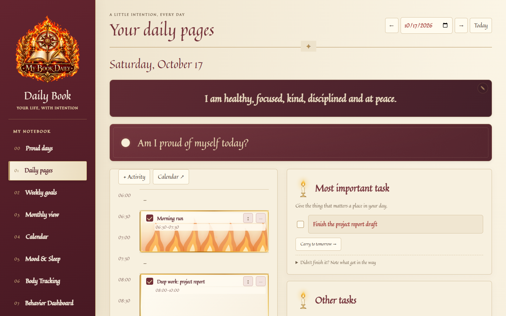
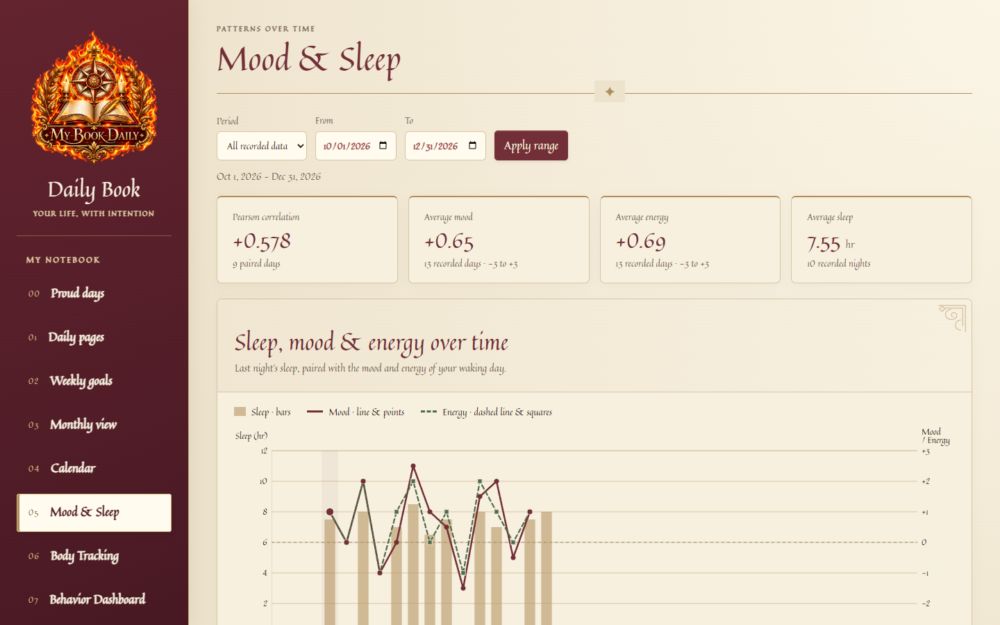
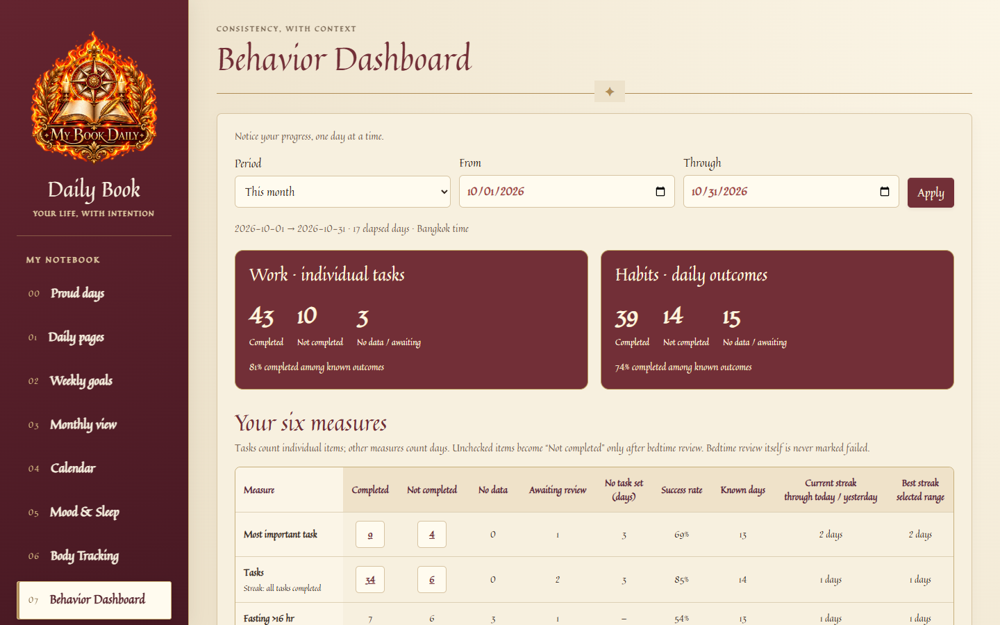
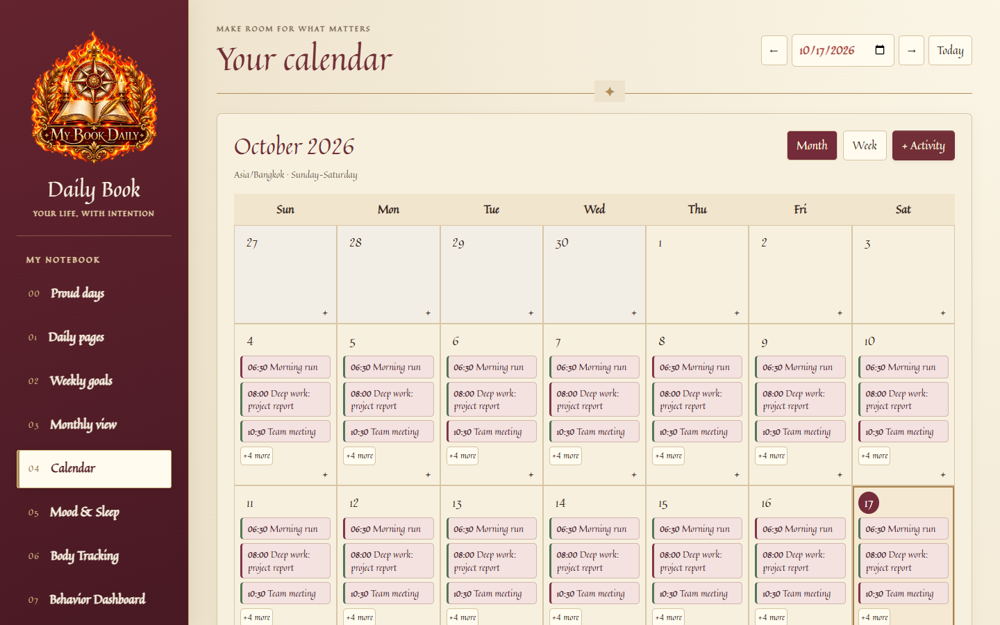
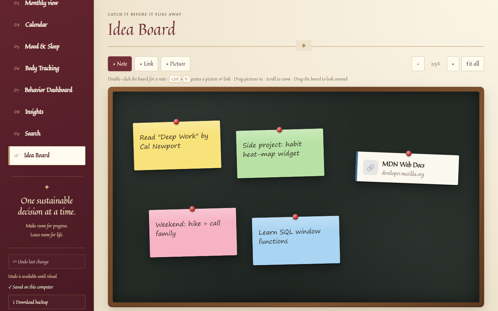

# Daily Book

A local-first daily planner and journal that runs in the browser and keeps every word on your own computer.
It combines an hourly schedule, goals, end-of-day reflections, habit tracking and charts in a "royal manuscript" theme.



## Why I built it

I wanted one place to plan the day, reflect at bedtime and see patterns over weeks and months, without handing a diary to a cloud service.
Daily Book runs a small Node.js server on `127.0.0.1`, stores the book as a JSON file, and works fully offline.

## Features

| Area | What it does |
|---|---|
| **Daily pages** | Hourly timeline with drag-to-move activities, overlapping and same-time events, most important task, tasks linked to goals, carry-to-tomorrow, reflections, bedtime review and a Markdown summary download |
| **Goals & reviews** | Weekly and monthly goals, plus "Your week / month, reflected" reviews with averages, streaks and a Markdown export |
| **Calendar** | Month/week views, all-day, overnight and recurring events, optional two-way **Google Calendar sync** (OAuth desktop flow, tokens encrypted with Windows DPAPI) |
| **Mood & Sleep** | Dual-axis chart of sleep hours vs. mood with Pearson correlation and a data table |
| **Body tracking** | Weight and body-fat charts and a cycle calendar |
| **Behavior Dashboard** | Success rate, best and current streaks for six daily habits, with drill-down to the source day |
| **Insights** | Compares days with and without a condition (e.g. 7+ hours sleep) and highlights the clearest differences |
| **Search** | Full-text search across reflections, tasks, goals and reviews |
| **Idea Board** | Zoomable chalkboard for sticky notes, links and pictures (paste, drag & drop) |
| **Safety** | Autosave with revision checks, atomic writes, tiered backups, automatic recovery from a damaged file, undo history |

## Tech stack

- **Frontend:** buildless HTML, CSS and vanilla JavaScript (no framework, no bundler)
- **Backend:** Node.js `http` server with **no runtime dependencies**, bound to loopback only, token-checked API
- **Integrations:** Google Calendar API (OAuth 2.0 with PKCE, loopback redirect), Windows notifications for a bedtime reminder
- **Testing:** `node:test` unit and server tests, and Playwright browser QA scripts that run on disposable data
- **Formatting:** Prettier

## Getting started

Requirements: [Node.js LTS](https://nodejs.org/) (Windows is needed for the Google token encryption and reminders; the planner itself is plain Node).

```bash
git clone https://github.com/Cpongrawee/daily-book.git
cd daily-book
npm start
```

Open http://127.0.0.1:47831. Your book is created in `data/` (gitignored, never committed).
On Windows you can also run `Start Daily Book.ps1`, which starts the server hidden and opens the browser.

## Tests

```bash
npm test                 # unit + server tests on disposable data
npm install              # once, installs Playwright for the browser QA
npm run qa               # browser QA on disposable data
```

The browser QA expects Google Chrome at its default Windows location.

## Project structure

```
server.cjs              HTTP server, storage, backups, recovery
google-calendar.cjs     Google Calendar OAuth + two-way sync
reminder.cjs            Bedtime reminder (Windows notification)
backup-retention.cjs    Tiered backup thinning
dist/                   Frontend: index.html, app.js and one module per view
tests/                  Unit tests (*.test.cjs) and browser QA (*-qa.cjs)
docs/USER_GUIDE.md      Detailed guide to every feature
```

## Screenshots

| Mood & Sleep | Behavior Dashboard |
|---|---|
|  |  |

| Calendar | Idea Board |
|---|---|
|  |  |

All screenshots use made-up demo data.

## Privacy

Everything stays on your computer. The only network traffic is the optional Google Calendar sync, which sends calendar events and nothing from your journal.
